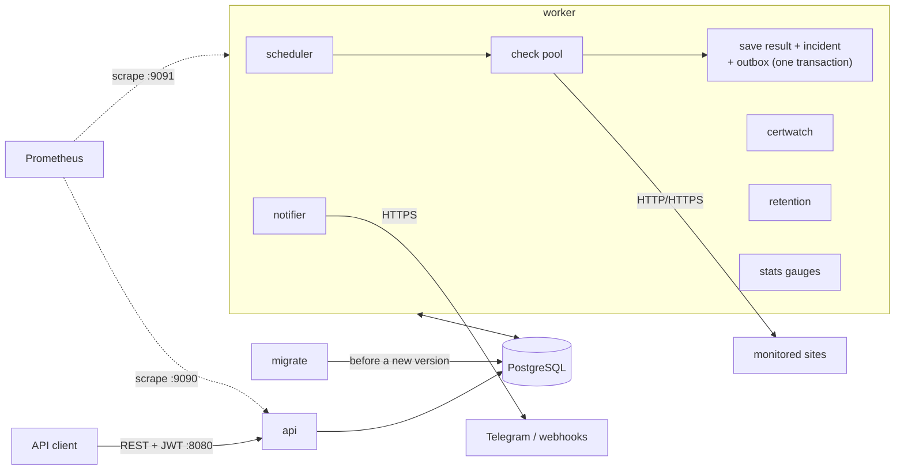
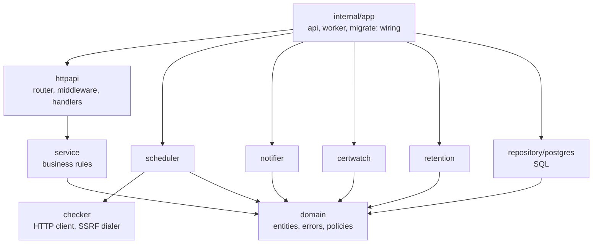
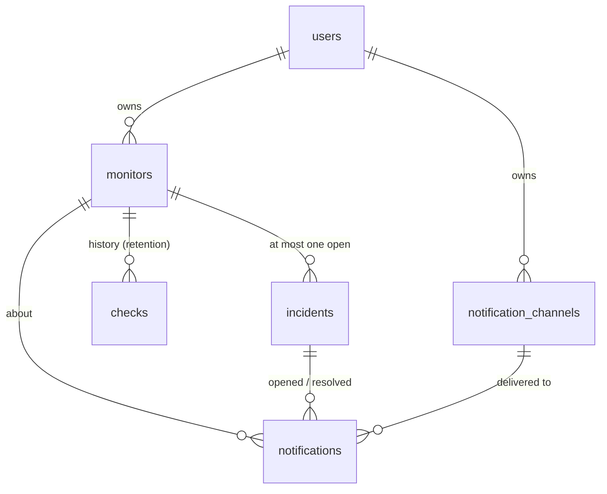
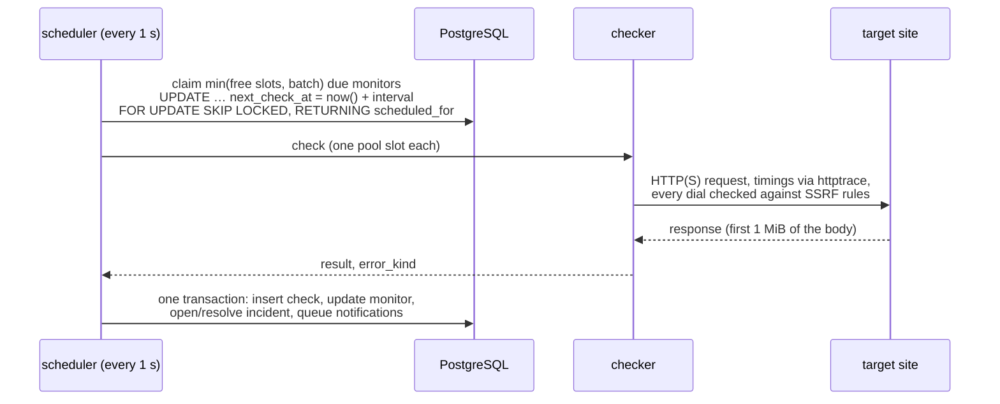

# Architecture

How Uptime Monitor is built and why it behaves the way it does in
operation. Choices are explained in [decisions.md](decisions.md) (numbers in
brackets refer to it); metrics are in [metrics.md](metrics.md), the build
and release pipeline in [ci-cd.md](ci-cd.md).

## Processes

One image, one static binary, three commands (039):

| Command | Role | Ports | Replicas |
|---|---|---|---|
| `api` | public REST API: auth, monitors, history, statistics, incidents, channels | `8080` public; `9090` ops (`/metrics`, optional pprof) | any number, stateless (except the in-memory auth rate limit, 013) |
| `worker` | scheduler and check pool, incidents, notification outbox, certificate warnings, retention, database-backed gauges | `9091` ops (`/healthz`, `/readyz`, `/metrics`) | any number: work is claimed with `FOR UPDATE SKIP LOCKED` |
| `migrate` | applies the embedded SQL migrations and exits | — | one at a time (advisory lock, 008) |

All state lives in PostgreSQL. Processes never talk to each other: the
database is the only shared component, which is what makes replicas,
rolling and blue/green deployments safe.



## Code layout



- `domain` depends on nothing: entities, domain errors and pure policies
  (the incident transition policy, 025).
- Interfaces are declared by the consumer: `service` says what storage it
  needs, `repository/postgres` and `repository/memory` (the fake for HTTP
  tests) implement it. The `api` and `worker` packages under `internal/app`
  are the only places that know every concrete type.
- No global state: the clock, the logger and the Prometheus registry are
  passed in (034); tests use a fake clock and their own registry.
- `cmd/*` are thin mains; `cmd/uptime-monitor` is the all-in-one binary of
  the image, which picks the command from the name it is started as.

## Data model



- `monitors.next_check_at` (partial index on active monitors) drives the
  scheduler; `status`, `consecutive_failures` and `tls_not_after` are the
  monitor's current health.
- `checks` is the only large table: one row per check, deleted after
  `CHECKS_RETENTION_DAYS`.
- `incidents` has a unique partial index on `monitor_id WHERE resolved_at
  IS NULL`: two open incidents for one monitor cannot exist.
- `notifications` is the outbox: `pending` → `sent` or `failed`, with
  `attempts`, `next_attempt_at` (also the lease) and `last_error`.
- Every API query filters by the owner; another user's resource answers
  404, like a missing one.

Migrations are expand/contract: every schema must work with the previous
release (README, Migrations).

## Request path (api)

```
RequestID → Metrics → Logging → Recover → BodyLimit (1 MiB) → route
    /api/v1/auth/*   → RateLimit (10/min per IP)
    other /api/v1/*  → Authenticate (JWT HS256)
```

Metrics wraps everything after it, so it times the whole request and sees
the final status, including a panic turned into a 500 by Recover (035). The
`route` label is the chi route template, never the raw path. Handlers decode
strictly (unknown fields are a 400, 014), call a service and map domain
errors to HTTP codes in one place (`internal/httpapi/response`). Internal
errors are logged with the request ID and answered with a generic 500.

There is no CORS middleware (046): the API has no browser client, and
without CORS headers browsers keep other sites from reading its responses.

## Check cycle (worker)



- Claiming moves `next_check_at` in the same statement, so two workers
  never take the same monitor, and a crashed worker costs at most one
  interval for the monitors it was checking (020).
- A worker claims only what fits in its pool: a claimed monitor starts at
  once and never waits in memory.
- The scheduler lag (`start − scheduled_for`) is the timeliness SLI.
- The health of a monitor, its incident and its notifications change in one
  transaction under the monitor row lock (025): a notification exists if
  and only if the incident change was committed.
- The heartbeat of the scheduler (every tick) feeds the worker's
  `/readyz`: older than 30 s means the loop is stuck.

## Notification delivery (worker)

- **Outbox:** notifications are rows written with the incident change
  (027). Every second each worker claims up to 10 due rows with `FOR
  UPDATE SKIP LOCKED` and moves `next_attempt_at` one minute ahead: that is
  the lease. Delivery happens outside any transaction.
- **At least once:** a worker that dies mid-delivery leaves the row to be
  claimed again after the lease; webhook receivers deduplicate by `id`.
- **Retries:** 30 s, 1 m, 2 m, 4 m; after five attempts, or at once for a
  permanent error (most 4xx, blocked address, disabled channel), the row is
  `failed` with `last_error` (028).
- **Content** is rendered at send time from the current monitor and
  incident.
- **Webhooks** are signed with HMAC-SHA256 over the raw body using a
  server-generated secret; redirects are not followed (029).
- **certwatch** (hourly) queues a `cert_expiring` notification once per
  certificate (`cert_alerted_for`), in one statement (032).

## Background loops (worker)

| Loop | Period | Does |
|---|---|---|
| scheduler | 1 s | claims and checks due monitors; heartbeat |
| notifier | 1 s | delivers due outbox rows |
| certwatch | 1 h | queues certificate expiry warnings |
| retention | at start, then 1 h | deletes checks older than `CHECKS_RETENTION_DAYS` in batches |
| stats | 15 s | refreshes the database-backed gauges (036) |
| ops server | — | `/healthz`, `/readyz`, `/metrics` on `:9091` |

They run in one `errgroup` with a shared context. A loop logs a failed
iteration (database error, timeout) and tries again on its next tick; it
returns only when the context ends. If one does return an error (the ops
server cannot listen), the context is cancelled, the others stop and the
process exits non-zero, for the orchestrator to restart it. On `SIGTERM` the
loops stop taking new work; running checks get `SHUTDOWN_TIMEOUT` (25 s) to
finish and save, then are aborted.

## Failure behaviour

| Failure | What happens | Seen in |
|---|---|---|
| PostgreSQL down | api: `/readyz` 503, requests needing data fail with 500, `/healthz` stays 200; worker: claims fail and are retried every tick, `/readyz` 503 | `/readyz`, `uptime_http_requests_total{code="500"}`, logs |
| worker crashes | its claimed checks are lost for one interval; in-flight deliveries are retried after the lease | scheduler lag, `uptime_notifications_total{status="retry"}` |
| target slow or down | the check times out after `timeout_seconds` (≤ 30 s) and counts as a failure; the pool slot is freed | `uptime_checks_total{result="failure"}` by `error_kind` |
| every target fails with `dns`/`connection` | most likely the worker's own network, not the targets | `error_kind` mix across all checks |
| pool saturated | due monitors wait; lag grows | `uptime_worker_pool_busy / size`, `uptime_scheduler_due_monitors`, lag histogram |
| Telegram or a webhook down | retries with backoff, then `failed` | `uptime_notifications_total`, oldest pending age |
| notifier stuck | the outbox grows | `uptime_notification_oldest_pending_age_seconds` |
| retention failing | `checks` keeps growing | `uptime_retention_last_success_timestamp_seconds` |
| migration fails | `migrate` exits non-zero; the new version is not started, the old one keeps running on the old schema | deploy logs |

## Security boundaries

- Only `:8080` is public. Ops ports are internal (038); the public router
  does not serve `/metrics`.
- The worker fetches user-chosen URLs: URL rules when a monitor or webhook
  is saved, and an address check on every connection (`net.Dialer.Control`)
  against DNS rebinding and redirects to internal addresses (019, README
  Security).
- Secrets come only from the environment; the webhook secret is shown once,
  the Telegram token is scrubbed from errors before they are logged or
  stored.
- The image is distroless, non-root, with a read-only root filesystem in
  compose (040, 041).

## Known limitations

- The auth rate limit is per API process (013): with N replicas a client
  gets N times the budget. A shared limiter (PostgreSQL or Redis) is the fix
  if that matters.
- Access tokens cannot be revoked before they expire (011); refresh tokens
  and logout are on the stretch list.
- Sent and failed notifications are kept forever (033); an outbox cleanup
  fits in the retention loop when the table grows.
- One location checks every monitor: a problem between the worker and a
  target looks like an outage of the target. Multi-region checks are on the
  stretch list.
